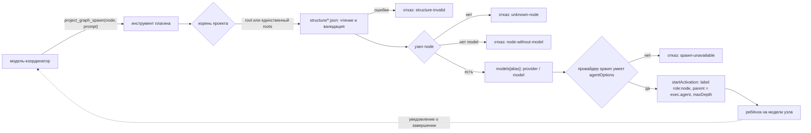

# MVP-1: порождение агента по узлу структуры

Дата: 2026-10-27. Решение заказчика: начинаем MVP-1 — узел графа становится
агентом с моделью из декларации.

## Схема

## Что решено

1. **Триггер — инструмент модели**, не кнопка панели и не автозапуск. Модель
   вызывает `project_graph_spawn({ node, prompt })`; панель остаётся только
   чтением.
2. **Модель берётся из декларации**, а не из аргументов инструмента: узел
   ссылается на алиас в `models`, алиас даёт `provider/model`. Выбор модели
   проходит git-ревью вместе со структурой.
3. **Родитель — вызывающий агент** (`exec.agent`): порождение идёт через
   `ctx.subagents.startActivation` штатного провайдера `spawn`.
4. **Роль попадает в артефакты**: `label` = `role:node`, поэтому уведомление и
   каталог детей несут роль, а не только id.
5. **Глубина — политика DSH**: `ctx.subagents.resolveMaxDepth`; свой счётчик
   плагин не заводит.

## Отказы (стабильные коды)

| Код | Когда |
| --- | --- |
| `no-roots` / `root-required` / `root-not-allowed` | корень не задан, неоднозначен или вне списка |
| `structure-invalid` | структура прочитана, но валидатор нашёл ошибки |
| `unknown-node` | узла с таким id нет |
| `node-without-model` | у узла нет модели (роль — только декларация) |
| `spawn-unavailable` | нет `ctx.subagents`, провайдера или он не умеет `agentOptions` |

## Чего MVP-1 не делает

- не запускает граф целиком и не выбирает, кому делегировать, — это решение
  вызывающей модели;
- не пишет в `structure/` и не меняет декларацию;
- не обходит политику глубины и не порождает внешние (одноразовые) бэкенды:
  только локальный `spawn`, потому что роль должна переживать продолжение.
